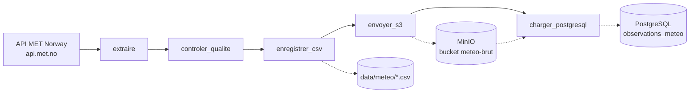

# Airflow Local — Pipeline météo ETL

Pipeline de données orchestré avec **Apache Airflow 3**, qui collecte toutes les 15 minutes la météo de trois villes (Paris, Dakar, Lomé), contrôle la qualité des données, les archive dans un stockage objet **S3 (MinIO)** et les charge dans **PostgreSQL**.

Tout tourne en local avec **Docker Compose**.

## Architecture



| Étape | Tâche | Ce qu'elle fait |
|---|---|---|
| 1 | `extraire` | Appelle l'API [MET Norway](https://api.met.no/) pour chaque ville et récupère la prévision la plus proche : température (°C), humidité (%) et vent (converti en km/h). 3 tentatives avec backoff exponentiel. |
| 2 | `controler_qualite` | Bloque le pipeline si les données sont incorrectes : villes manquantes, en double ou inconnues, champs vides, date sans fuseau horaire, valeurs non numériques ou hors limites (température entre −100 et 65 °C, humidité entre 0 et 100 %, vent entre 0 et 500 km/h). |
| 3 | `enregistrer_csv` | Écrit un CSV horodaté dans `data/meteo/`. |
| 4 | `envoyer_s3` | Archive le CSV dans MinIO : `s3://meteo-brut/observations/`. |
| 5 | `charger_postgresql` | Relit le CSV **depuis S3**, puis fait un upsert dans la table `observations_meteo`. Les relances ne créent donc pas de doublons. |

### Table PostgreSQL

```sql
CREATE TABLE observations_meteo (
    ville            TEXT NOT NULL,
    observation_utc  TIMESTAMPTZ NOT NULL,
    temperature      DOUBLE PRECISION,
    humidite         DOUBLE PRECISION,
    vent             DOUBLE PRECISION,
    date_ingestion   TIMESTAMPTZ DEFAULT NOW(),
    PRIMARY KEY (ville, observation_utc)
);
```

La table est créée automatiquement au premier chargement.

## DAGs

| DAG | Planification | Rôle |
|---|---|---|
| `meteo_pipeline` | toutes les 15 min | Le pipeline ETL décrit ci-dessus |
| `test_meteo_postgres` | manuel | Vérifie que la connexion `meteo_postgres` fonctionne |
| `ceps_test_auto` | toutes les 2 min | DAG d'exemple minimal (extraire → transformer → afficher) |

## Stack

- **Apache Airflow 3.3** (CeleryExecutor, TaskFlow API `airflow.sdk`)
- **PostgreSQL 16** : métadonnées Airflow et données météo
- **Redis 7.2** : broker Celery
- **MinIO** : stockage objet compatible S3
- **Docker Compose**

## Structure du projet

```
.
├── dags/
│   ├── meteo_pipeline.py        # Pipeline ETL principal
│   ├── test_meteo_postgres.py   # Test de connexion PostgreSQL
│   └── ceps_test_auto.py        # DAG d'exemple
├── docker-compose.yaml          # Stack Airflow (officielle)
├── compose.s3.yaml              # Service MinIO
├── .env.example                 # Variables d'environnement à copier
├── config/                      # airflow.cfg (non versionné)
├── data/                        # CSV générés (non versionné)
├── logs/                        # Logs Airflow (non versionné)
└── plugins/
```

## Installation

### Prérequis

- Docker et Docker Compose v2
- Environ 4 Go de RAM disponibles pour Docker

### 1. Cloner le dépôt

```bash
git clone https://github.com/EL-K-Code/airflow-local.git
cd airflow-local
```

### 2. Configurer les variables d'environnement

```bash
cp .env.example .env
```

Remplis ensuite `.env` :

```bash
# UID de ton utilisateur (Linux / WSL)
echo "AIRFLOW_UID=$(id -u)"

# Générer une clé Fernet
python -c "from cryptography.fernet import Fernet; print(Fernet.generate_key().decode())"
```

Choisis aussi un mot de passe solide pour `MINIO_ROOT_PASSWORD`.

### 3. Créer les dossiers et initialiser Airflow

```bash
mkdir -p logs data plugins config
docker compose -f docker-compose.yaml -f compose.s3.yaml up airflow-init
```

### 4. Lancer la stack

```bash
docker compose -f docker-compose.yaml -f compose.s3.yaml up -d
```

| Service | URL | Identifiants |
|---|---|---|
| Airflow | http://localhost:8080 | `airflow` / `airflow` |
| Console MinIO | http://localhost:9001 | `minioadmin` / valeur de `MINIO_ROOT_PASSWORD` |

### 5. Créer le bucket MinIO

Dans la console MinIO, crée un bucket nommé **`meteo-brut`**.

### 6. Créer les connexions Airflow

Dans **Admin → Connections** :

**`minio_s3`** (type *Amazon Web Services*)
- AWS Access Key ID : `minioadmin`
- AWS Secret Access Key : valeur de `MINIO_ROOT_PASSWORD`
- Extra :
  ```json
  { "endpoint_url": "http://minio:9000" }
  ```

**`meteo_postgres`** (type *Postgres*)
- Host : `postgres`
- Port : `5432`
- Login / Password : `airflow` / `airflow`
- Database : `airflow` (ou une base dédiée que tu crées)

Tu peux ensuite lancer `test_meteo_postgres` pour vérifier la connexion.

### 7. Activer le pipeline

Les DAGs sont en pause à leur création. Active `meteo_pipeline` dans l'interface : il s'exécutera toutes les 15 minutes.

## Vérifier les données

```bash
docker compose exec postgres psql -U airflow -d airflow \
  -c "SELECT ville, observation_utc, temperature, humidite, vent
      FROM observations_meteo
      ORDER BY observation_utc DESC
      LIMIT 10;"
```

## Notes

- **User-Agent** : l'API MET Norway exige un User-Agent identifiable. Remplace l'adresse de contact `USER_AGENT` dans `dags/meteo_pipeline.py` par la tienne.
- **Ajouter une ville** : il suffit de l'ajouter au dictionnaire `VILLES` avec sa latitude et sa longitude. Le contrôle qualité s'adapte automatiquement.
- **Sécurité** : `.env` et `config/airflow.cfg` contiennent des secrets et sont exclus du dépôt. Les identifiants par défaut (`airflow` / `airflow`) ne conviennent qu'à un usage local.

## Arrêter la stack

```bash
docker compose -f docker-compose.yaml -f compose.s3.yaml down
# Ajouter -v pour supprimer aussi les volumes (base PostgreSQL)
```
